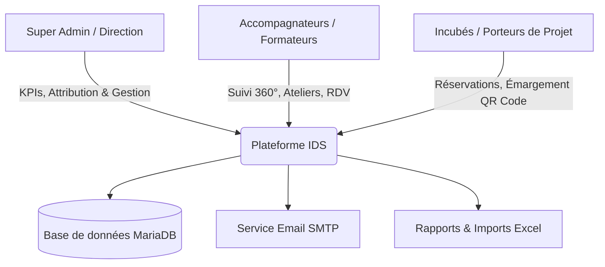
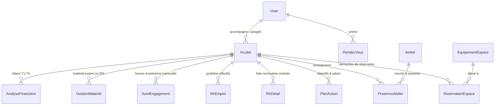

# 📘 Rapport Complet : Plateforme Incubateur Digital Solidaire (IDS) & Fablab

> **Application Fullstack de Gestion d'Incubateur, Suivi des Porteurs de Projet, Réservation d'Espaces & Émargement Numérique**

---

## 1. Présentation Générale & Mission

La plateforme **Incubateur Digital Solidaire (IDS)** est une solution web fullstack sur-mesure conçue pour digitaliser, centraliser et piloter l'ensemble du cycle de vie de l'accompagnement entrepreneurial au sein de l'incubateur et du Fablab (CGS).

Elle résout les problématiques clés de gestion :
* **Suivi à 360° des porteurs de projet (incubés)** à travers toutes les dimensions : statut juridique, ressources humaines, équipements alloués, assiduité, jalons d'action et indicateurs financiers.
* **Réservation et exploitation des espaces et équipements techniques** (Fablab, coworking, machines de découpe laser, imprimantes 3D, studios).
* **Organisation des sessions de formation et ateliers**, avec émargement numérique en temps réel par QR Code.
* **Communication automatique et proactive** via un moteur d'emails transactionnels harmonisé.
* **Imports / Exports massifs de dossiers** depuis et vers Microsoft Excel.



---

## 2. Stack Technologique Complète

L'application repose sur une architecture moderne, découplée et robuste.

### 2.1 Frontend (Interface Client)
* **Framework & Bundler :** [React.js](https://react.dev/) (v18.2) orchestré par [Vite](https://vitejs.dev/) (v5.0) pour des temps de build ultra-rapides et un rechargement à chaud instantané (HMR).
* **Routage :** [React Router](https://reactrouter.com/) (v6.21) gérant les routes privées, publiques et les restrictions selon les rôles.
* **Design & Styling :** 
  * [Tailwind CSS](https://tailwindcss.com/) (v3.4) configuré avec un système de design tokens bimodal (**Mode Clair / Mode Sombre**).
  * Palette personnalisée : **Navy IDS** (`#0c87eb`, `#00254d`) et **Ambre/Or IDS** (`#f59e0b`, `#fbbf24`).
  * Typographie moderne avec la police Google Fonts **Inter**.
* **Visualisation de Données :** [Chart.js](https://www.chartjs.org/) & [react-chartjs-2](https://react-chartjs-2.js.org/) pour les graphiques de performances (camemberts de phases, barres de CA trimestriel, courbes d'assiduité).
* **Iconographie :** [Lucide React](https://lucide.dev/) (plus de 50 icônes vectorielles légères).
* **Système de Feedback & Toasts :** [react-hot-toast](https://react-hot-toast.com/) avec thématisation automatique (clair / sombre) et retours visuels instantanés.
* **Traitement Excel :** [SheetJS (xlsx)](https://docs.sheetjs.com/) pour le parsing côté client de classeurs Excel multi-feuilles et la génération d'exports.
* **Génération de QR Codes :** [qrcode.react](https://github.com/zpao/qrcode.react) pour l'émargement dynamique des ateliers de formation.
* **Client HTTP :** [Axios](https://axios-http.com/) configuré avec intercepteurs pour l'injection automatique du token JWT et la gestion centralisée des erreurs 401/403.

### 2.2 Backend (Serveur d'API REST)
* **Environnement & Serveur :** [Node.js](https://nodejs.org/) (>= v20.0) et framework [Express.js](https://expressjs.com/) (v4.18).
* **Couche ORM (Accès aux Données) :** [Sequelize ORM](https://sequelize.org/) (v6.35) avec migrations et associations relationnelles fortes (clés étrangères, cascades).
* **Authentification & Chiffrement :** 
  * [JSON Web Token (jsonwebtoken)](https://jwt.io/) pour la gestion des sessions sans état (Stateless Authentication).
  * [bcryptjs](https://github.com/dcodeIO/bcrypt.js) pour le hachage sécurisé des mots de passe (12 rounds de salage).
* **Gestion des Fichiers & Médias :** [Multer](https://github.com/expressjs/multer) configuré pour l'upload local des photos de profil des incubés et pièces jointes.
* **Messagerie Transactionnelle :** [Nodemailer](https://nodemailer.com/) avec templates HTML adaptatifs, support SMTP réel (Gmail, OVH, etc.) et mode simulation sécurisé pour le développement.
* **Validation & Sécurité :** [express-validator](https://express-validator.github.io/docs/) pour l'assainissement et la validation stricte des entrées utilisateurs, [CORS](https://expressjs.com/en/resources/middleware/cors.html) et gestion des variables d'environnement via `dotenv`.

### 2.3 Base de Données
* **SGBD relationnel :** [MariaDB](https://mariadb.org/) / [MySQL](https://www.mysql.com/) (Port 3306), moteur InnoDB garantissant les propriétés ACID et l'intégrité référentielle.

---

## 3. Modèle de Données & Schéma Relationnel

La base de données est structurée autour de **13 modèles relationnels** :



### Synthèse des Tables :
1. **`users`** : Accompagnateurs et administrateurs (nom, prénom, email, mot de passe hashé, rôle `super_admin` / `admin`, statut actif).
2. **`incubes`** : Fiche d'identité complète de chaque porteur de projet (nom, CIN/PP, raison sociale, statut juridique, phase du projet, date de démarrage, photo, assignation à un `admin_id`).
3. **`gestion_materiel`** : Inventaire du matériel alloué ou propre (article, numéro de série, quantité, valeur, état).
4. **`suivi_engagement`** : Suivi mensuel de l'assiduité (taux de présence aux formations, moyenne d'heures de présence par semaine, initiatives, observations).
5. **`rh_emploi`** : Indicateurs macro de création d'emplois (permanents, temporaires, stagiaires).
6. **`rh_detail`** : Détail nominatif des salariés créés (nom, poste, nature de contrat CDI/CDD/ANAPEC, salaire, dates).
7. **`plan_action`** : Feuilles de route opérationnelles (actions prioritaires, objectifs, échéances, état d'avancement).
8. **`analyses_financieres`** : Suivi financier ventilé sur les 4 trimestres (T1, T2, T3, T4) : Chiffre d'Affaires prévisionnel vs réalisé, charges d'exploitation, résultat net, investissements.
9. **`ateliers`** : Catalogue des formations et événements (thème, formateur, date, créneau horaire, durée, description, statut).
10. **`presence_ateliers`** : Émargements aux sessions de formation (statut présent/absent, horodatage, signature électronique).
11. **`equipements_espaces`** : Référentiel des espaces physiques (Coworking, Fablab, Studio vidéo, Salles de réunion) et machines disponibles.
12. **`reservations_espaces`** : Enregistrement des créneaux de réservation (espace, créneau horaire, motifs, matériel associé, état `en_attente`, `valide`, `refuse`).
13. **`impact` (Calculs consolidés)** : Vues et calculs d'agrégation globale pour le tableau de bord exécutif.

---

## 4. Architecture des Rôles & Sécurité (RBAC)

L'accès à l'application est cloisonné selon le principe du moindre privilège :

| Fonctionnalité | Super Admin (Directeur) | Admin (Accompagnateur) |
|---|:---:|:---:|
| **Tableau de Bord Exécutif (`/dashboard`)** | ✅ Accès complet aux KPIs globaux | ❌ Redirection automatique |
| **Gestion des Utilisateurs (`/utilisateurs`)** | ✅ Création, suspension, rôles | ❌ Accès interdit |
| **Périmètre de l'Annuaire (`/incubes`)** | ✅ Vue globale de tous les incubés | 👁️ Uniquement ses incubés assignés |
| **Attribution / Réassignation de dossier** | ✅ Modification de l'accompagnateur | ❌ Attribution fixe |
| **Fiches de Suivi Opérationnel (6 onglets)** | ✅ Consultation & édition | ✅ Consultation & édition |
| **Gestion des Espaces & Réservations** | ✅ Validation et paramétrage | ✅ Consultation et réservation |
| **Événements & Émargement par QR Code** | ✅ Gestion complète | ✅ Gestion et présence |

---

## 5. Modules Fonctionnels Détaillés

### 5.1 Tableau de Bord Stratégique & KPIs d'Impact
* **Indicateurs clés en temps réel :** Nombre total d'entreprises accompagnées, Chiffre d'Affaires cumulé annuel et trimestriel (T1 $\rightarrow$ T4), volume d'emplois durables créés.
* **Graphiques décisionnels :**
  * Répartition des incubés par stade de maturité (Idéation, Lancement, Croissance, Autonomie).
  * Évolution chronologique du chiffre d'affaires et des recrutements.
* **Filtres contextuels :** Analyse par année, par phase de projet ou par accompagnateur.

### 5.2 Annuaire des Incubés & Fiche Dossier 360°
Chaque incubé dispose d'un dossier centralisé divisé en **6 sous-modules spécialisés** :
1. **Informations Générales :** Raison sociale, porteur de projet, coordonnées, statut légal, secteur d'activité, photo et historique d'assignation.
2. **Gestion du Matériel :** Traçabilité des équipements du Fablab confiés sous convention (ordinateurs, cartes électroniques, outillage) et matériel propre de la startup.
3. **Assiduité & Engagement :** Saisie mensuelle des heures de présence physique au Fablab/Coworking et calcul automatique du taux d'assiduité aux ateliers obligatoires.
4. **Ressources Humaines & Emplois :** Enregistrement des recrutements, ventilation par type de contrat (CDI, CDD, Stage), masse salariale.
5. **Plan d'Action :** Tableau de bord de type Kanban/Jalons pour le suivi des livrables opérationnels (MVP, business plan, étude de marché, immatriculation).
6. **Analyse Financière Trimestrielle :** Synthèse budgétaire détaillée comparant les prévisions aux réalisations réelles sur chaque trimestre.

### 5.3 Module Événements, Ateliers & Émargement par QR Code
* **Planification d'ateliers :** Date, durée, formateur référent, programme pédagogique.
* **Convocations groupées :** Envoi en un clic des convocations par email à tous les incubés concernés.
* **Émargement numérique par QR Code (`/presence/:id`) :** 
  * Projection ou affichage d'un QR code dynamique à l'entrée de la salle de formation.
  * Les incubés scannent le code avec leur smartphone pour signer numériquement leur présence.
* **Rapports d'assiduité et feuilles d'émargement imprimables :** Génération de feuilles de présence officielles conformes aux exigences des bailleurs de fonds et partenaires institutionnels.

### 5.4 Module Booking : Espaces de Travail & Équipements Fablab
* **Espaces gérés :** Fablab (impression 3D & découpe laser), Espace Coworking, Studio Audio/Vidéo, Salles de réunion.
* **Calendrier interactif :** Visualisation graphique des créneaux libres et occupés par jour et par semaine.
* **Workflow de réservation :**
  * Demande de créneau par l'incubé ou l'administration.
  * Validation ou refus motivé par l'équipe administrative.
  * Envoi automatique d'email de confirmation ou de refus circonstancié.
* **Lien de réservation public (`/reserver-espace/:espace`) :** Interface simplifiée permettant aux porteurs de projet de soumettre une réservation sans friction.

### 5.5 Moteur d'Emails Transactionnels
Un service dédié (`emailService.js`) gère **8 types d'emails automatisés**, parfaitement harmonisés au style clair de la plateforme :
1. ✅ **Confirmation de Réservation d'Espace**
2. ❌ **Notification de Refus de Réservation avec motif**
3. 📅 **Confirmation de Rendez-vous de Mentoring / Suivi**
4. 🎓 **Convocation officielle à un Atelier / Formation**
5. ⚠️ **Alerte automatique d'Assiduité insuffisante** (taux < 80% ou heures < 15h/semaine)
6. 🚀 **Email de Bienvenue & transmission des identifiants temporaires**
7. 🔔 **Rappel automatique d'Atelier (24h ou 2h avant le début)**
8. 🔔 **Rappel automatique de Réservation de machine (2h avant le créneau)**

### 5.6 Import / Export Excel Global
* **Modal d'Import Massif :** Permet d'importer l'intégralité des données d'un dossier incubé depuis un fichier Excel (`.xlsx`) structuré (Informations, Matériel, RH, Finances, Engagement).
* **Sécurisation & Parsing :** Validation automatique des colonnes, assainissement des types de données et détection des doublons avant enregistrement en base.

---

## 6. Ergonomie & Design System

* **Bimodalité intégrée :** Prise en charge native du **Mode Clair** (épuré, lumineux, contrasté) et du **Mode Sombre** (ardoise foncée `#0f172a`, reposant pour les yeux), avec mémorisation de la préférence dans le `localStorage`.
* **Design Responsive :** Sidebar rétractable adaptative, interface fluide utilisable sur écran large de bureau, tablette ou smartphone.
* **Accessibilité et lisibilité :** Contraste renforcé des textes, badges de statut aux couleurs normalisées (Vert = Valide, Rouge = Alerte/Refus, Bleu = Session/Info, Ambre = Attention).

---

## 7. Commandes d'Exploitation & Démarrage

```bash
# 1. Installation de l'ensemble des dépendances (Racine, Backend et Frontend)
npm run install:all

# 2. Lancement en mode développement local
# Démarrer le Backend (Port 5000)
npm run dev:backend

# Démarrer le Frontend (Port 5173)
npm run dev:frontend

# 3. Compilation pour la mise en production
npm run build
```
