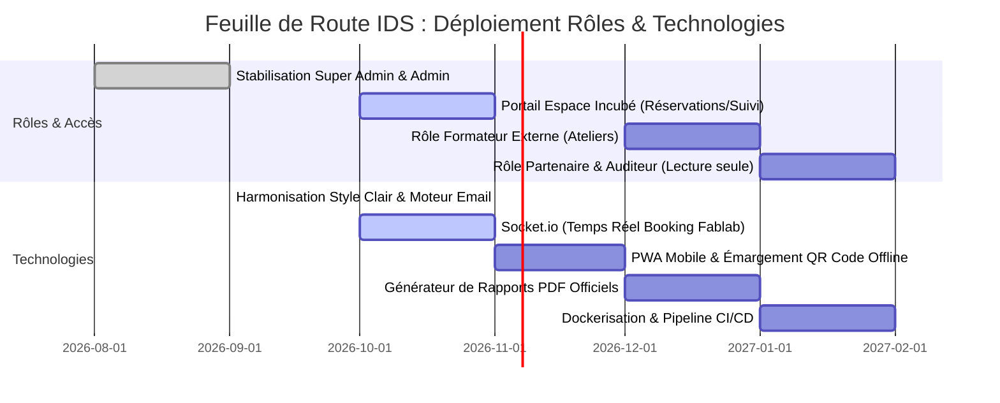

# 🗺️ Roadmap Stratégique : Rôles & Technologies — Plateforme IDS Incubateur

> **Feuille de route pour l'évolution des profils d'utilisateurs (RBAC) et l'architecture technologique de l'Incubateur Digital Solidaire & Fablab.**

---

## 📌 Sommaire
1. [Vision Globale du Projet](#1-vision-globale-du-projet)
2. [Roadmap des Rôles & Gestion des Accès (RBAC)](#2-roadmap-des-rôles--gestion-des-accès-rbac)
   * 2.1 [État Actuel (Phase 1 — En Production)](#21-état-actuel-phase-1--en-production)
   * 2.2 [Prochaine Étape (Phase 2 — Court Terme) : Portail Incubé](#22-prochaine-étape-phase-2--court-terme--portail-incubé)
   * 2.3 [Évolution Avancée (Phase 3 — Moyen/Long Terme) : Écosystème Élargi](#23-évolution-avancée-phase-3--moyenlong-terme--écosystème-élargi)
   * 2.4 [Matrice Complète des Permissions (Actuelle & Cible)](#24-matrice-complète-des-permissions-actuelle--cible)
3. [Roadmap Technologique & Architecture Logicielle](#3-roadmap-technologique--architecture-logicielle)
   * 3.1 [Stack Actuelle (Socle Solide)](#31-stack-actuelle-socle-solide)
   * 3.2 [Jalon 1 (Court terme) : Temps Réel & PWA Mobile](#32-jalon-1-court-terme--temps-réel--pwa-mobile)
   * 3.3 [Jalon 2 (Moyen terme) : Performance, PDF & Traitements Asynchrones](#33-jalon-2-moyen-terme--performance-pdf--traitements-asynchrones)
   * 3.4 [Jalon 3 (Long terme) : DevOps, Sécurité & Cloud Industriel](#34-jalon-3-long-terme--devops-sécurité--cloud-industriel)
4. [Calendrier Prévisionnel de Déploiement](#4-calendrier-prévisionnel-de-déploiement)

---

## 1. Vision Globale du Projet

L'application IDS passe d'un **outil d'administration interne** pour l'équipe encadrante à un **véritable écosystème collaboratif et interactif** reliant la direction, les accompagnateurs, les porteurs de projet (incubés), les formateurs et les partenaires institutionnels.

```
┌─────────────────────────────────────────────────────────────────────────┐
│                     ÉCOSYSTÈME MULTI-RÔLES IDS                          │
├───────────────────┬───────────────────┬─────────────────────────────────┤
│   SUPER ADMIN     │       ADMIN       │            INCUBÉ               │
│   (Direction)     │  (Accompagnateur) │      (Porteur de Projet)        │
│   KPIs & Pilote   │  Suivi 360° & RDV │  Réservations, Formations &Suivi│
├───────────────────┴───────────────────┴─────────────────────────────────┤
│                 FORMATEUR EXPERT  │  PARTENAIRE / BAILLEUR              │
│                 Ateliers & Présence│  Rapports d'Impact RSE en lecture  │
└─────────────────────────────────────────────────────────────────────────┘
```

---

## 2. Roadmap des Rôles & Gestion des Accès (RBAC)

### 2.1 État Actuel (Phase 1 — En Production)

Actuellement, l'application est opérationnelle avec un cloisonnement strict à 2 niveaux :

#### 👑 1. Super Admin (`super_admin` / Directeur)
* **Périmètre :** Vision transversale et décisionnelle globale.
* **Fonctionnalités exclusives :**
  * **Dashboard Exécutif (`/dashboard`) :** Chiffre d'Affaires cumulé (T1 $\rightarrow$ T4), emplois créés, répartition des projets par stade.
  * **Administration des Accès (`/utilisateurs`) :** Création, modification, suspension des comptes accompagnateurs.
  * **Réassignation Dynamique :** Pouvoir exclusif de transférer un dossier incubé d'un accompagnateur à un autre.
  * **Annuaire Global :** Visualisation et édition de tous les incubés sans restriction.

#### 🧑‍🏫 2. Admin / Accompagnateur (`admin` / Coach - Formateur)
* **Périmètre :** Gestion opérationnelle multi-tenant restreinte à son portefeuille d'incubés.
* **Fonctionnalités :**
  * **Filtrage automatique :** Ne voit que les incubés où `admin_id === user.id`.
  * **Suivi à 360° :** Édition des 6 onglets (Infos, Matériel, Assiduité, RH, Plan d'action, Finances).
  * **Organisation :** Planification des rendez-vous de mentoring, des ateliers de formation et des réservations de salles/machines.

---

### 2.2 Prochaine Étape (Phase 2 — Court Terme) : Portail Incubé

#### 🚀 3. Rôle Porteur de Projet (`incube`)
* **Objectif :** Offrir à l'incubé son propre espace connecté personnel (à la suite de la réception de son email de bienvenue automatique).
* **Fonctionnalités cibles :**
  * **Espace Réservation Autonome :** Réserver des créneaux de machines Fablab (découpe laser, imprimantes 3D) ou de coworking, avec visibilité immédiate sur les disponibilités.
  * **Mon Assiduité & Présences :** Visualiser son taux de présence aux ateliers et son quota d'heures hebdomadaire au Fablab.
  * **Feuille de Route & Jalons :** Consulter les objectifs fixés avec son accompagnateur dans son plan d'action.
  * **Historique des Rendez-vous :** Voir les prochains points d'étape programmés et les notes laissées par le coach.
  * **Mise à jour de son profil :** Mettre à jour sa photo, ses coordonnées et les déclarations de recrutements (RH).

---

### 2.3 Évolution Avancée (Phase 3 — Moyen/Long Terme) : Écosystème Élargi

#### 🎓 4. Rôle Intervenant / Formateur Externe (`formateur`)
* **Objectif :** Faciliter la tenue des sessions de formation sans donner accès aux données financières confidentielles des startups.
* **Fonctionnalités cibles :**
  * Accès restreint au module Événements pour les seuls ateliers dont il est le formateur assigné.
  * Lancement et projection du QR Code d'émargement en direct.
  * Validation manuelle des présences/retards et saisie d'appréciations pédagogiques sur les participants.

#### 🤝 5. Rôle Partenaire / Bailleur de Fonds (`partenaire` / `auditeur`)
* **Objectif :** Transparence et reporting institutionnel (Bailleurs, Ministères, Fonds de soutien).
* **Fonctionnalités cibles :**
  * Accès en **lecture seule** (`read-only`) à une vue de synthèse d'impact social et économique :
    - Nombre d'entreprises passées par l'incubateur.
    - Ratio de pérennité des projets à 1 an et 2 ans.
    - Total des emplois féminins et masculins créés.
    - Taux d'utilisation globale des machines du Fablab.
  * Téléchargement de rapports d'audit certifiés sans données nominatives personnelles (conformité RGPD / CNDP).

---

### 2.4 Matrice Complète des Permissions (Actuelle & Cible)

| Module / Action | Super Admin | Accompagnateur (`admin`) | Incubé (`incube`) | Formateur | Partenaire |
|---|:---:|:---:|:---:|:---:|:---:|
| **Dashboard KPIs & CA Global** | ✅ Lecture/Export | ❌ | ❌ | ❌ | 👁️ Lecture (Anonymisée) |
| **Gestion des Utilisateurs** | ✅ CRUD complet | ❌ | ❌ | ❌ | ❌ |
| **Création d'un Incubé** | ✅ Tout accompagnateur | ✅ Assignation automatique | ❌ | ❌ | ❌ |
| **Réassigner un Incubé** | ✅ | ❌ | ❌ | ❌ | ❌ |
| **Dossier 360° (Finances, RH, Matériel)** | ✅ Tous les incubés | ✅ Ses incubés | 👁️ Sa propre fiche (Lecture/Édition partielle) | ❌ | ❌ |
| **Réservation Espaces / Fablab** | ✅ Valider / Refuser | ✅ Réserver / Consulter | 📝 Demande de créneau | ❌ | ❌ |
| **Ateliers : Création & Convocations** | ✅ | ✅ | 👁️ Inscription & Suivi | 📝 Gestion de sa session | ❌ |
| **Émargement par QR Code** | ✅ | ✅ | ✍️ Signature présence | ✅ Validation | ❌ |
| **Imports / Exports Excel** | ✅ Global | ✅ Ses incubés | ❌ | ❌ | 📥 Téléchargement rapports |

---

## 3. Roadmap Technologique & Architecture Logicielle

### 3.1 Stack Actuelle (Socle Solide)

```
┌─────────────────────────────────────────────────────────────┐
│                       SOCLE ACTUEL                          │
├──────────────────────────────┬──────────────────────────────┤
│ FRONTEND                     │ BACKEND                      │
│ • React 18 + Vite 5          │ • Node.js + Express          │
│ • Tailwind CSS (Clair/Sombre)│ • Sequelize ORM + MariaDB    │
│ • Chart.js + Lucide React    │ • JWT + Bcryptjs             │
│ • SheetJS (xlsx)             │ • Nodemailer (8 templates)   │
│ • QR Code React              │ • Multer Upload              │
│ • React Hot Toast            │ • Express-Validator          │
└──────────────────────────────┴──────────────────────────────┘
```

---

### 3.2 Jalon 1 (Court terme) : Temps Réel & PWA Mobile

| Technologie | Objectif Métier | Bénéfice Apporté |
|---|---|---|
| **Socket.io / WebSockets** | Synchronisation en direct des réservations de machines Fablab | Évite les doubles réservations en temps réel sur le calendrier sans avoir à rafraîchir la page. |
| **Progressive Web App (PWA)** | Application installable sur smartphone sans passer par l'App Store | Les incubés peuvent badger/émarger et réserver directement depuis leur téléphone comme une application native. |
| **Service Worker & Mode Hors-Ligne** | Fonctionnement dans les zones blanches du Fablab | Possibilité de consulter son planning et saisir des présences même en cas de coupure réseau temporaire. |

---

### 3.3 Jalon 2 (Moyen terme) : Performance, PDF & Traitements Asynchrones

| Technologie | Objectif Métier | Bénéfice Apporté |
|---|---|---|
| **BullMQ + Redis** | File d'attente (Queue) asynchrone pour les emails | Envoi immédiat et fluide de 50+ convocations par email sans ralentir ou bloquer l'interface de l'accompagnateur. |
| **Puppeteer ou PDFKit** | Moteur de génération de PDF officiels | Génération en 1 clic d'une convention d'incubation personnalisée, d'une attestation de présence ou d'un bilan trimestriel complet. |
| **Cache Redis** | Mise en cache des requêtes lourdes du Dashboard | Temps de réponse du Dashboard divisé par 10 lors du calcul des agrégats de CA et d'emplois sur plusieurs années. |

---

### 3.4 Jalon 3 (Long terme) : DevOps, Sécurité & Cloud Industriel

| Technologie | Objectif Métier | Bénéfice Apporté |
|---|---|---|
| **Docker & Docker Compose** | Conteneurisation standardisée (Frontend + Backend + MariaDB) | Déploiement reproductible en un clic sur n'importe quel serveur (VPS, AWS, DigitalOcean, OVH). |
| **GitHub Actions (CI/CD)** | Intégration continue & Déploiement automatique | Exécution automatique des tests de non-régression et mise en ligne sécurisée à chaque commit. |
| **Sauvegarde Cloud S3 Automatisée** | Sauvegarde quotidienne chiffrée de la base de données | Protection contre la perte de données matérielle ou accidentelle. |
| **2FA (Authentification à Double Facteur)** | Sécurité renforcée pour les comptes Super Admin | Code SMS ou TOTP (Google Authenticator) obligatoire pour protéger les données confidentielles des entreprises. |

---

## 4. Calendrier Prévisionnel de Déploiement



---

## 5. Recommandations Immédiates

1. **Priorité 1 :** Activer la route et l'interface du **Portail Incubé** pour permettre aux porteurs de projet de se connecter avec leurs identifiants reçus par le moteur d'email.
2. **Priorité 2 :** Intégrer **Socket.io** sur le calendrier des réservations pour une actualisation instantanée du Fablab.
3. **Priorité 3 :** Mettre en place un script de génération de **bilan PDF en un clic** pour faciliter les présentations aux comités de pilotage.
